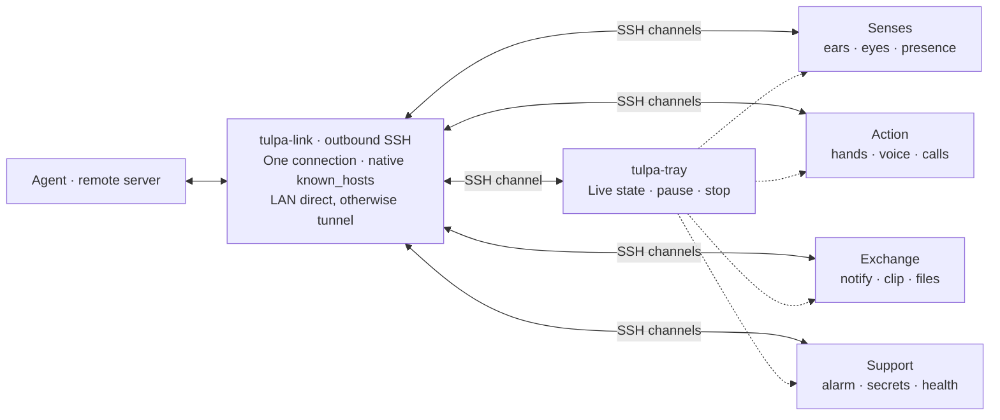

# tulpa

### A thought-form with hands.

Your agent lives on a server. Your world is on your Mac. **tulpa gives one a body in the other**: ears to listen, a voice to answer, eyes across your displays, and hands to get things done. One outbound SSH connection carries it all. A menu-bar presence keeps the human in control, with visible activity, a pause hotkey, and a stop button within reach.

*The name comes from the Tibetan idea of a thought-form.*<br>
*Here, the thought-form gains hands in the world.*

> **Demo GIF · coming soon**<br>
> A request, a visible action, a pause. This space is reserved for the first real recording.

<!-- Replace the demo placeholder with docs/demo.gif when a working demo exists. -->

**Today:** Tulpa is a menu-bar app for macOS. It keeps one outbound SSH link to a hub, the server end where the agent lives, and gives the agent its organs over it: **ears** (a capture of the microphone and the system audio, with transcript lines sent as events), a **voice** (`voice.say`, in a macOS voice or the agent's own), **hands** (files, git and named commands inside the roots the Mac's owner allows, or any command in full mode, with big files on a data stream beside the link) and **eyes** (`eyes.photo`, one camera still on request; built and tested with a stand-in camera, not yet run on a Mac). The menu shows their state and has **Pause all** and **Quit**. Screen capture, calls, alarms and the other organs are not built yet, and there are no tagged releases.

## What runs today

### The link

The app runs the Mac's own OpenSSH client, `ssh -W`, to one endpoint on the server side, with `BatchMode=yes` and `StrictHostKeyChecking=yes`: an unknown or changed host key fails the attempt. The Mac listens on nothing. Requests and replies are JSON lines on that one stream, and Tulpa pushes events on it unasked. On a listed office Wi-Fi it first dials the server's LAN addresses directly; elsewhere it goes through the SSH alias, which may use a jump host. A dropped link is dialed again after 5 s, and failed attempts back off, doubling up to 5 min.

### Ears

Tulpa starts a capture command of yours as its own child, so macOS attributes the microphone and system-audio capture to Tulpa.app. The capture records two sides, `me` (the microphone) and `them` (the system audio: the other side of a call, or a video), and its transcriber appends lines to transcript files. Tulpa checks both sides 15 s after a start and every 30 s after: one failing side is DEGRADED, both are DEAF, and the reason says `(lid closed)` when the lid is shut. It reads the transcripts and sends the agent the lines the mode allows:

| Mode | Meant for | Transcript lines the agent gets |
| --- | --- | --- |
| `off` | not listening | none: no capture runs |
| `office` | at the office | lines with a wake word, either side |
| `alone` | alone with the owner | every microphone line; a system-audio line only with a wake word |
| `meeting` | a meeting in the room | lines with a wake word, either side |
| `call` | a call | lines with a wake word, either side |
| `stream` | a stream | lines with a wake word, either side |

- Each mode runs its own capture command (`[ears.modes]`); one script for every mode is fine. Transcript lines, mode changes and `ears.status` carry the mode.
- Wake words (`[ears] wake_words`) match only as whole words, in any case and any script. `[ears] wake_aliases` lists the transcriber's known misspellings of them. With neither, only `alone` microphone lines go.
- The capture may cut one phrase into several lines, and only the first carries the wake word. So after a wake-word line, the next lines on its side go too while each comes within `[ears] followup_secs` (8 s unless set; 0 turns it off) of the last one that went, marked `"continuation":true`. The other side's lines stay. In a call, only your own side gets this window: the other party's wake-word line goes, their next lines do not. The window closes `[ears] followup_max_secs` (30 s unless set; never 0 while the window is on: no value means no limit) after the wake-word line however many lines keep coming, and a mode switch or Pause closes it sooner.
- `[ears] transcript_events` caps this per Mac: `wake` sends only wake-word lines and their follow-up, even alone; `none` sends nothing.
- A line may carry a speaker tag, as in `HH:MM:SS [me] [owner] text`; the event carries it as `speaker`.
- Lines written while paused or while no capture runs never go. The local log keeps no transcript text.
- The mode survives a restart: Tulpa saves the mode last chosen and starts in it again. Pause, `ears.stop` and `ears.mode off` save `off`; Quit saves nothing.
- A system-audio tool built on ScreenCaptureKit stops while the display sleeps or the screen is locked, and the ears report `them` DEGRADED. A fallback through a Core Audio process tap is being investigated.

### Voice

`voice.say <text>`, up to 500 characters, speaks on the Mac and answers once the speech has played.

- It speaks in a macOS voice (`/usr/bin/say`, `[ears] voice`) or in the agent's own voice, such as a cloned one: a synthesis command of yours (`voice_synth`), or a resident one that keeps its model loaded (`voice_serve`). The own voice speaks sentence by sentence and renders the next sentence while one plays; `say` takes over any sentence it fails.
- `[voice] rate`, from 0.5 to 2, sets the speed. It is applied once, by whatever plays the sound.
- **Voice output** in the menu picks the output device for `say` and for a resident voice that plays itself.
- Pause refuses it and cuts a sentence short.

### Hands

| Hands mode | What the agent may do |
| --- | --- |
| off | nothing |
| on | `read`, `list`, `git.status`, `git.diff` and `git.log` inside the policy's roots, and `run` for the commands the policy names. Each can be `on`, `off` or `ask`: a question in a dialog and in the menu, with **Allow** and **Deny** (the dialog is not yet run on a Mac). |
| full | also `shell` (any command, as the user) and `write` (any file), and `read` and `list` at any path |

- The policy, `~/.config/tulpa/hands.toml`, is edited on the Mac only: outside full mode the hands can neither read nor write it. A deny list (`~/.ssh`, `~/Library`, key files, shell histories and more) wins over every root.
- A reply is cut at 256 KB, and private keys and tokens become `[secret]` before they leave the Mac. Every request is one line in the local activity log, without a `write`'s content.
- Pause kills a running command's whole process group.

### The menu

From top to bottom: the link and its route; a hands question waiting for **Allow** or **Deny**; the hands' state and **Hands: full**; **Ears: <mode>**, the ears line, **Ears mic** and **Voice output**; the keep-awake line; **Open config**; **Pause all**; **Quit**.

- A click on a DEGRADED ears line opens the System Settings pane that fixes it.
- **Ears mic** greys out a microphone whose name the capture's ffmpeg would misread, one with a `:` or a leading digit. Name such a device in the capture script instead.
- **Pause all** refuses every hands verb and `voice.say`, kills a running command and the capture, and saves the ears mode as off. Resume does not restart the capture. There is no pause hotkey yet.
- **Quit** stops Tulpa until it is opened again or the next login: the installer's LaunchAgent starts it again only after a crash or a kill. The next start comes back in the saved ears mode.

### Keep-awake

A Mac that sleeps drops the link, and nothing reaches it until someone wakes it. Tulpa holds `caffeinate -i -s -w <its pid>` for as long as it runs (`[keepawake] always`, on by default), and the menu shows it: `keep-awake: on (always, -is)`. `[keepawake] flags` picks other assertions from the letters `d`, `i`, `m`, `s` and `u`, such as `-d` to keep the display awake; a value it can't use is logged, and the default is held. A `caffeinate` that keeps ending is started again, backing off up to 60 s. While `update.sh` swaps the app, it and its rollback job each hold a `caffeinate -dimsu` of their own. No separate keep-awake agent is needed.

## Install

Builds and signing are local. There is no auto-update.

1. `scripts/bundle-macos.sh` builds and signs `Tulpa.app` with a stable self-signed code-signing identity from the login keychain. Keep that identity: a build signed with another one loses the macOS grants.
2. `scripts/make-installer.sh` builds one zip per Mac: the signed app, a config, a link token, an SSH entry and the server's host keys. The server's details are passed in, never committed. The token also goes to the hub.
3. On the Mac, the owner unpacks the zip and double-clicks `install.command`. It installs `~/Applications/Tulpa.app`, keeps any existing config, key and SSH entry, makes `~/.ssh/tulpa_ed25519` when absent, sets up the LaunchAgent (`KeepAlive = { SuccessfulExit = false }`, `ProcessType = Interactive`), starts Tulpa, and prints the Mac's public key to authorize on the server.
4. The installer leaves the ears off. Set up `[ears]` in `~/.config/tulpa/config.toml` with a capture script of your own ([config.example.toml](config.example.toml) documents every key). A person at the Mac grants Tulpa **Microphone** and **Screen & System Audio Recording**.
5. Update a Mac with `packaging/macos/update.sh`. It swaps the bundle with a launchd dead-man armed first, which puts the old app back unless the new one checks in with the hub. Rehearse it on a Mac you can reach another way ([REHEARSAL.md](packaging/macos/REHEARSAL.md)).

[Installing and maintaining Tulpa](docs/DEVELOP.md) has every step, the rules that keep a remote Mac reachable, and the known gaps.

## One link. Many organs.



This is the design: organs on SSH channels of one connection, with no listening ports — apart from a port forward the agent asks for, which listens on loopback only, only while it is open, and always shows in the menu. Today the app carries every organ on its one `ssh -W` stream, routed by verb. The transport spike, `tulpa-link`, uses `russh` with existing OpenSSH identities and native `known_hosts` / `authorized_keys`. It has verified Bonjour-first discovery, live tunnel fallback, OpenSSH aliases with ProxyJump/ProxyCommand, agent and GUI-Keychain authentication to restricted stock `sshd`, and stock-`ssh` interoperability with a throwaway `russh` node. Changed keys fail closed; unknown keys require an explicit trust decision under `StrictHostKeyChecking ask`.

## The human has the controls

What the app does today, and what is still a design requirement:

- **See it:** the menu shows the link, the hands, the ears, the eyes and the keep-awake as they change. macOS permission prompts and capture indicators stay visible. A local append-only activity log lives in `~/Library/Logs/tulpa/`; written content, spoken text and transcript text never go in it.
- **Pause it:** **Pause all** in the menu turns every sense off. **Quit** stops the app until it is opened again or the next login. *Not yet:* a pause hotkey.
- **Bound it:** a local policy names the permitted commands and filesystem roots, with a deny list, and each verb group can ask first. *Not yet:* tmux windows; hands jobs with their own IDs, cancellation and streamed output; GUI actions through Accessibility, AppleScript or a Shortcuts bridge.
- **Choose what is shared:** the ears mode, the wake words and `transcript_events` decide which transcript lines leave the Mac. The capture runs as Tulpa's own child, so microphone and system-audio permission belong to the app. The camera takes one still only when the agent asks and `[eyes] mode` allows it, through a helper inside the signed bundle, so the camera grant is Tulpa's too (not yet run on a Mac). *Not yet:* screen capture of all displays with a window-exclusion list, notifications, call recording, and the ears helper inside the signed bundle.
- **Revoke it:** stop the app, revoke its macOS permissions, or remove its authorized key on the server. Local policy and the server's authorized-key restrictions are the security boundary.
- **Keep keys local:** the link uses the Mac's own OpenSSH configuration. The installer makes a dedicated key, `~/.ssh/tulpa_ed25519`, without a passphrase, so `BatchMode` can use it unattended; its line on the server is where it is revoked. Real configuration stays in `~/.config/tulpa/config.toml`, outside this public repository. *Design:* existing ssh-agent identities where possible, and encrypted-key passphrases from Keychain or a prompt, never logged.

Builds and signing happen locally, using one stable self-signed certificate to preserve TCC grants across rebuilds. No auto-update is planned; `update.sh` is run by hand.

## The organs

Each organ has its own library crate under `crates/`. **Planned** means a documented trait exists; **spike** means feasibility work is underway; **in the app** means the menu-bar app does it today, as [Using Tulpa](docs/USE.md) describes, even where the code lives in `tulpa-tray` rather than in the organ's own crate.

| Organ / crate | Responsibility | Status |
| --- | --- | --- |
| `tulpa-link` | One outbound SSH connection, native known-host trust, OpenSSH identities, LAN / tunnel route | Spike · agent and OpenSSH interop verified. The app dials with OpenSSH `ssh` meanwhile. |
| `tulpa-hands` | Parallel policy-bound shell, files, git, tmux, GUI, and Shortcuts jobs | In the app · files, git, named commands, full-mode shell and write; no tmux, GUI, Shortcuts or job control yet |
| `tulpa-ears` | Microphone → VAD → streaming ASR, partial and final transcripts | In the app, in `tulpa-tray` · runs your capture command, checks it and sends its transcript lines; VAD and ASR are that command's. The crate is still a trait. |
| `tulpa-voice` | Interruptible playback of incoming TTS audio | In the app, in `tulpa-tray` · `voice.say`, cut short by Pause. The crate is still a trait. |
| `tulpa-eyes` | All-display screenshots / ScreenCaptureKit, window exclusions, camera on request | In the app, not yet run on a Mac · `eyes.photo`: the bundle's Swift helper takes one camera still, the crate keeps it private until it is fetched. Screen capture is planned. |
| `tulpa-calls` | Join / answer Zoom, Meet, or FaceTime; record both sides, transcribe, private hints | Planned |
| `tulpa-alarm` | Local timers and wake-ups that ring even without the link | Planned |
| `tulpa-presence` | Idle / lock state, active display, Bluetooth / Wi-Fi proximity | Planned |
| `tulpa-notify` | Show notifications; read incoming notifications when allowed | Planned |
| `tulpa-clip` | Policy-bound clipboard exchange | Planned |
| `tulpa-files` | Drop zone in, share out, inside allowed roots | In the app · the always-on `files.put` channel into one inbox directory (the drop zone), bundle archives staged for the login build check; sharing out is planned |
| `tulpa-secrets` | Read-only OpenSSH Keychain passphrases with zeroizing handoff | Spike · GUI-session exchange verified |
| `tulpa-health` | Link / organ state, CPU, thermal, and battery vitals | Planned |
| `tulpa-tray` | Menu-bar state, pause all, full stop, local activity log | In the app · the menu-bar app itself, with the link, ears, voice and keep-awake; no pause hotkey yet |

`crates/tulpa` is the app entry point; `crates/tulpa-ears-helper` is the future bundled microphone helper. The traits describe initial seams, not a settled wire protocol or async runtime.

## Roadmap

The app already has the ears, with `meeting` and `call` modes, the hands, `voice.say` and a camera still on request. Screen capture and the remaining organs are not built yet.

1. **Finish the platform and SSH spike.** Prove native identity selection, real OpenSSH logins in both directions, host-key decisions, permission ownership, pause, and the absence of listening sockets before building full organs.
2. **Build calls and the meeting assistant first.** Capture the call app's output and the human's microphone as separate labelled streams; diarize speakers locally; send live partial and final transcripts to the agent; show quiet text prompts only to the human; produce notes and action items after the call; join or answer only on an explicit request. See [the calls design](docs/calls.md).
3. **Then build eyes and the remaining organs.**

## Documentation

- [Using Tulpa](docs/USE.md): the verbs and what they answer, ears and hands modes, events, the menu, and what DEGRADED and DEAF mean.
- [Installing and maintaining Tulpa](docs/DEVELOP.md): build, install, update, keep-awake, and the rules that keep a remote Mac reachable.
- [Rehearsing an update](packaging/macos/REHEARSAL.md): the dead-man in both directions, on a Mac you can reach another way.

## Build

Install stable Rust with `rustfmt` and `clippy`, then run:

```sh
cargo build --workspace --locked
cargo test --workspace --locked
cargo run --locked --bin tulpa
cargo run --locked --bin tulpa-ears-helper
```

`tulpa` reads `~/.config/tulpa/config.toml`, or the path given as its one argument. With `[tray] enabled = true` it runs the menu-bar app; otherwise it prints its status and exits. On non-macOS builds an enabled tray is refused with an explicit error. `tulpa-ears-helper` is still a skeleton that prints its status and requests no permissions. The core is portable Rust, and its tests run anywhere; the menu-bar presenter, the app bundle and its signing need macOS.

Before committing:

```sh
cargo fmt --all -- --check
cargo clippy --workspace --all-targets --all-features --locked -- -D warnings
cargo test --workspace --all-features --locked
cargo deny --locked check
```

Install the CI-matched dependency checker with `cargo install cargo-deny --version 0.20.2 --locked`. CI runs these checks on a GitHub-hosted macOS runner, with SHA-pinned actions and no repository secrets.

[config.example.toml](config.example.toml) documents the configuration. Its values are placeholders and every organ is off. Keep all real configuration outside the checkout.

## License

[MIT](LICENSE). Built in the open; private configuration stays private.
