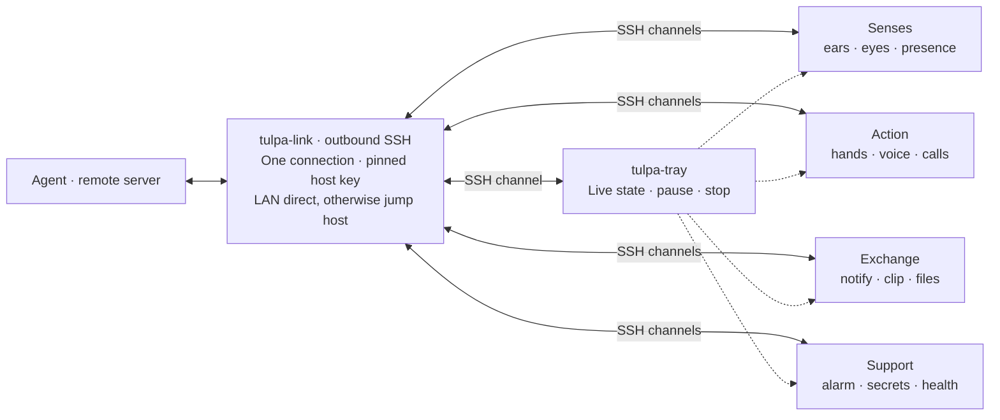

# tulpa

### A thought-form with hands.

Your agent lives on a server. Your world is on your Mac. **tulpa gives one a body in the other**: ears to listen, a voice to answer, eyes across your displays, and hands to get things done. One outbound SSH connection carries it all. A menu-bar presence keeps the human in control, with visible activity, a pause hotkey, and a stop button within reach.

*The name comes from the Tibetan idea of a thought-form.*<br>
*Here, the thought-form gains hands in the world.*

> **Demo GIF · coming soon**<br>
> A request, a visible action, a pause. This space is reserved for the first real recording.

<!-- Replace the demo placeholder with docs/demo.gif when a working demo exists. -->

**Today:** the transport spike has verified Bonjour-first discovery and live tunnel fallback. The protected-key signer and fail-closed host pinning have unit tests, but real key creation and SSH login await provisioned signing. There is no live agent connection, capture, automation, or app bundle yet.

## One link. Many organs.



The transport design uses SSH channels for organs, with no listening ports. The first spike will test `russh` with a custom Secure Enclave P-256 signer; `libssh-rs` is the fallback. A changed or missing pinned host key must fail closed.

## The human has the controls

These are design requirements; the skeleton does not implement them yet.

- **See it:** the tray shows every organ's live state. macOS permission prompts and capture indicators stay visible. A local append-only activity log lives in `~/Library/Logs/tulpa/`.
- **Pause it:** one hotkey turns all senses off. The tray also offers a full stop.
- **Bound it:** local policy names permitted commands, filesystem roots, and tmux windows. Hands jobs have their own IDs, cancellation, and streamed output. GUI actions use Accessibility / AppleScript or a Shortcuts bridge under OS permissions.
- **Choose what is shared:** screen capture covers all displays with an explicit window-exclusion list; camera access is on request. Notifications and call recording need permission too. The ears helper will live inside the signed app bundle so microphone permission belongs to the app.
- **Revoke it:** stop the app, revoke its macOS permissions, or remove its authorized key on the server. Local policy and the server's authorized-key restrictions are the security boundary.
- **Keep keys local:** signing uses Keychain / Secure Enclave protection. The agent never receives raw keys. Real configuration stays in `~/.config/tulpa/config.toml`, outside this public repository.

Builds and signing happen locally, using one stable self-signed certificate to preserve TCC grants across rebuilds. No auto-update is planned.

## The organs

Each organ has its own library crate under `crates/`. **Planned** means a documented trait exists; **spike** means feasibility work is underway; **working** means a real implementation has been verified.

| Organ / crate | Responsibility | Status |
| --- | --- | --- |
| `tulpa-link` | One outbound SSH connection, pinned host key, Secure Enclave signing, LAN / tunnel route | Spike · discovery verified; SSH login pending |
| `tulpa-hands` | Parallel policy-bound shell, files, git, tmux, GUI, and Shortcuts jobs | Planned |
| `tulpa-ears` | Microphone → VAD → streaming ASR, partial and final transcripts | Planned |
| `tulpa-voice` | Interruptible playback of incoming TTS audio | Planned |
| `tulpa-eyes` | All-display screenshots / ScreenCaptureKit, window exclusions, camera on request | Planned |
| `tulpa-calls` | Join / answer Zoom, Meet, or FaceTime; record both sides, transcribe, private hints | Planned |
| `tulpa-alarm` | Local timers and wake-ups that ring even without the link | Planned |
| `tulpa-presence` | Idle / lock state, active display, Bluetooth / Wi-Fi proximity | Planned |
| `tulpa-notify` | Show notifications; read incoming notifications when allowed | Planned |
| `tulpa-clip` | Policy-bound clipboard exchange | Planned |
| `tulpa-files` | Drop zone in, share out, inside allowed roots | Planned |
| `tulpa-secrets` | Keychain-guarded operations without exporting raw keys | Planned |
| `tulpa-health` | Link / organ state, CPU, thermal, and battery vitals | Planned |
| `tulpa-tray` | Menu-bar state, pause hotkey, stop, local activity log | Planned |

`crates/tulpa` is the app entry point; `crates/tulpa-ears-helper` is the future bundled microphone helper. The traits describe initial seams, not a settled wire protocol or async runtime.

## Build

Install stable Rust with `rustfmt` and `clippy`, then run on macOS:

```sh
cargo build --workspace --locked
cargo test --workspace --locked
cargo run --locked --bin tulpa
cargo run --locked --bin tulpa-ears-helper
```

Both binaries currently print their skeleton status and exit. They request no permissions. The skeleton is portable Rust; future macOS adapters and bundle signing will need native build tooling.

Before committing:

```sh
cargo fmt --all -- --check
cargo clippy --workspace --all-targets --all-features --locked -- -D warnings
cargo test --workspace --all-features --locked
cargo deny --locked check
```

Install the CI-matched dependency checker with `cargo install cargo-deny --version 0.20.2 --locked`. CI runs these checks on a GitHub-hosted macOS runner, with SHA-pinned actions and no repository secrets.

[config.example.toml](config.example.toml) documents the intended configuration. Its values are placeholders and every organ is disabled. The transport spike parses the link section from an explicitly supplied local file; keep all real configuration outside the checkout.

## License

[MIT](LICENSE). Built in the open; private configuration stays private.
